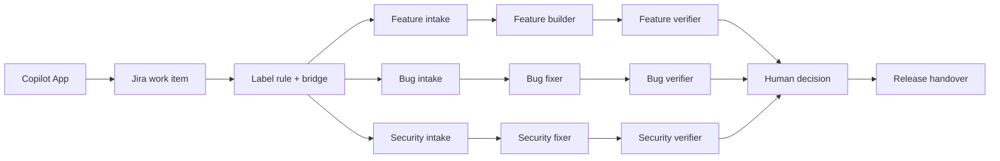

# Jira to Review-Ready Workshop

## A 120-minute Copilot Automations workshop

**Challenge:** Reduce business-request waiting times. Turn one small, synthetic Jira work item into an independently checked draft pull request, with traceable evidence and an explicit human release decision, using GitHub Copilot Automations and Automation Groups driven entirely from the GitHub Copilot App.

**Recommended format:** 40 people in 10 teams of 4; one isolated private/internal training repository per team; Jira as the source of truth; GitHub Copilot App as the only AI workspace during the timed session. One facilitator plus three floating coaches, one familiar with each path (Feature, Bug, Security).

This workshop concerns **GitHub Copilot App and Copilot Automations**, not Microsoft Copilot Studio.

### Repository map

| File | Audience | Purpose |
|---|---|---|
| [`README.md`](README.md) | Organizers and facilitators | Design, prerequisites, integration recipe, agenda, measurement and recovery playbook |
| [`docs/workshop.md`](docs/workshop.md) | Participants | Three independent paths with embedded prompts: New Feature / Bug Fix / Security Fix, plus the skills bonus |
| [`docs/automation-prompt-pack.md`](docs/automation-prompt-pack.md) | Participants and coaches | Copy-ready prompts P0-P9, runtime instructions for Shared Automations and Automation Groups |

### How they work today, and where the workshop helps

**Today:** A business request, bug or security issue is logged in Jira as a Work Item. It waits to be taken into account, then waits for development, testing and approval, until the production release.

**In the workshop:**

1. A work item is logged in Jira.
2. A specific Jira label is added: `ai:feature`, `ai:bug` or `ai:security`.
3. A prepared Jira rule and external bridge use that label to invoke the entry Automation of the matching group: **New Feature**, **Bug Fix** or **Security Fix**.
4. Explicit GitHub events hand work between members. Feature uses its execution issue, PR and verifier comment; Bug and Security also use shared group artifacts.
5. A human reviews the evidence and decides. No automatic merge or deployment.

### What this design does and does not promise

- Participants use the App to read and label Jira work, create automations, inspect runs and PRs, review evidence and record decisions. No participant CLI, IDE or Jira-browser exercise is required.
- **Before the event**, administrators prepare Jira rules, credentials, repository policies and the integration bridge. Some administrative setup requires Jira/GitHub administration surfaces; it is not established that ordinary MCP issue tools can administer these settings.
- A Jira label change is **not a native Copilot Automation trigger in the live catalog inspected on 16 November 2026**. A preconfigured Jira rule and authenticated integration bridge invoke the relevant automation through the supported API.
- A group is not an executable pipeline by itself. The bridge starts its **entry automation**; explicitly configured events start the later members.
- The reference Feature members are enabled even though their group description says paused. The workshop creates the matching members paused for review, then enables them after the bridge is bound. Copying their settings does not prove that the bridge or event handoffs have run.
- A draft PR, green checks or an accepted API call is not a production release. The workshop ends at a human-reviewed release handover; a real production release is out of scope.
- No customer repository, Jira site, skill repository or bridge has been tested by this material. The example repositories used while planning are **not workshop targets**. No automations, Jira items or repository changes were created while preparing this pack.

### Every team workstation

**Owner: participants, supported by endpoint administrators.** See also the participant [minimum prerequisites](docs/workshop.md#minimum-prerequisites).

1. Install the approved GitHub Copilot App build and complete GitHub sign-in/SSO before the event. Rehearse on the customer's managed devices and network.
2. Confirm access to the team repository, a usable model, cloud sessions, the Automations view, and group creation/management.
3. Open **Customize > MCP** to find the approved Jira/Atlassian connection and complete the consent flow. Use **Customize > Installed** to inspect installed connections.
4. Confirm the App can open PRs and show run evidence. An editor/document canvas is sufficient for the team result sheet; a Jira canvas is helpful but optional.
5. If a browser preview is part of the feature exercise, prevalidate it. It is not necessary for the API-based bug/security exercises.

The public template workshop supports App or CLI. **This adaptation uses the App only.** Agents may execute approved tools behind the App; participants do not switch to a terminal or IDE.

**Readiness gate:** The team shows the organizer the correct repository and Jira item open in the App, one completed read-only App interaction (prompt P0), and the ability to open a PR. Participants with incompatible machines pair on a prepared workstation; do not spend the workshop debugging installations.

Source: [customizing the Copilot App](https://docs.github.com/en/enterprise-cloud@latest/copilot/how-tos/github-copilot-app/customize-github-copilot-app).

### Organizer setup kit

Provide constraints, templates and recovery material, not finished automations. Complete before the timer starts.

#### A. Jira setup

**Owner: Jira administrator and workshop lead.**

1. Prepare a Jira Cloud training project, shown here as `AFKLAB`, containing only invented data. Jira Data Center requires a separately validated integration; do not assume Cloud instructions apply.
2. Provide Feature/Story, Bug and Security work types, or an agreed existing-type mapping. A custom Security issue type is optional; the route label is authoritative.
3. Prepare one work item per team plus duplicate, ambiguous and missing-information examples. Add `workshop-2026` and `team-01` through `team-10` labels. Do **not** preapply the three `ai:*` routing labels to the main exercises.
4. Give participants permission to browse, edit labels and comment on their training items. Restrict real security issues with Jira issue-security controls; no real findings are copied into broadly visible training repositories.
5. Provide an administrator-controlled mapping from team/component to repository. A free-text repository URL in a work item is not authority to redirect execution.
6. Prepare the label-change rule and bridge in [section 6](#6-organizer-integration-recipe-jira-label-to-group-entry). Rehearse all three routes before the event.
7. Agree real status/transition IDs before using them. Suggested training states are Ready for AI, In Progress, Ready for Review and Done, but the workshop works with comments if those states do not exist. Do not mark Done merely because a PR was opened.
8. Retain the label-change event time and event/change identifier for measurement and duplicate handling. Include a way for the facilitator to inspect integration failures from the App.

#### B. GitHub setup

**Owner: organization/repository administrators.**

1. Create ten **private or internal** training repositories in the customer's approved organization; current cloud automations are not available in public repositories.
2. Enable Copilot cloud agent and Automations under the applicable organization/enterprise policies. Enable organization-billed cloud usage for Shared Automations.
3. Give each team write access to its repository and approved access to the shared skills repository. Establish a budget owner and event-wide consumption limits.
4. Protect the default branch. Require the existing CI and independent human review. Keep merge and production deployment permissions out of the automations.
5. Supply a small airline-themed starter application with local fixtures, reproducible tests and a documented build/test command. Rehearse setup and targeted checks in the actual cloud runtime; aim for checks that complete in a few minutes.
6. Seed the three exercises described in the [participant workshop](docs/workshop.md#choose-one-of-three-paths). Keep the existing baseline tests green; each task adds the missing behavioral test. Provide a pinned rescue revision, prebuilt evidence pack and known-good group configuration for coaches.
7. Precreate these GitHub handoff labels for the relevant path: `workshop:feature:ready`, `workshop:feature:verify`, `workshop:bug:ready`, `workshop:bug:verify`, `workshop:security:ready`, `workshop:security:verify`. These are **GitHub** labels, separate from the Jira `ai:*` labels.
8. Record exact repository, group and automation IDs in the organizer's roster. A display name is not an API identifier.

Do not silently relax a repository's enforced write-scope or actor restrictions to make a demonstration work. Resolve policy incompatibilities during rehearsal.

#### C. MCP and integration setup

**Owner: integration/security administrators.**

| Capability | Needed by | Evidence before the day |
|---|---|---|
| Jira search/read/edit/comment | Interactive App | Read one synthetic item; add and remove a harmless test label without losing existing labels. |
| GitHub automation/group management | Interactive App | List available tools/triggers and show access to create Shared Automations/groups in a training repository. |
| Reference Feature configuration | Feature teams' Interactive App | Read the [reference group](https://github.com/octofred-airlines/web/agents/automations/groups/4922c35e-e50c-5600-bb59-c010ebeba975) and all three full member configurations and prompts through GitHub Automation tools. Access to the team's repository alone does not establish this. |
| Jira label dispatch | Jira rule + bridge | Label change launches the exact entry automation and returns a traceable request/task ID. |
| Bridge route binding and status | Coach's App through an approved administration MCP | Bind a new group entry ID within the team's allowlisted repository and read dispatch status; no secret exposure. |
| GitHub code/issue/PR operations | Cloud group members | Actual smoke run demonstrates each stage's narrowly selected tools. |
| Shared artifact storage | Bug/Security and optional skills-demo members | Producer writes a test record and a consumer in the same group/ownership reads it. The reference Feature members do not use artifacts. |
| Optional Jira writeback | Cloud verifier or approved bridge | Authenticated comment on a training item from that execution context, not merely from the App. |
| Organizational skills | Cloud execution repository | Required skill and resources are present at the pinned revision and actually loaded in a cloud smoke run. |

**Local access is not cloud access.** An MCP connection working in the App does not prove that a Shared Automation can authenticate to it. Configure and test repository-level cloud MCP access separately. The basic lab can run from a sanitized bridge payload without Jira access in the cloud; the participant then posts the evidence summary to Jira from the App.

Do not place tokens in prompts, issue text, skill files or sample JSON. Keep secrets in the approved secret store. Limit MCP credentials to training resources; GitHub trigger write-scope controls do not constrain an external MCP server's credentials.

For Feature, confirm the target policies permit repository-scoped intake writes and trigger-scoped downstream writes. Both downstream triggers accept Copilot-generated events but also require actor write permission; rehearse the actual actor and event delivery rather than assuming these settings alone guarantee a handoff. A trigger-scoped Builder can update its triggering issue and a PR created in that same run, not an arbitrary older PR. Stop on a policy incompatibility rather than broadening permissions.

Sources: [MCP concepts and cloud access](https://docs.github.com/en/enterprise-cloud@latest/copilot/concepts/customizations/mcp), [repository MCP configuration](https://docs.github.com/en/enterprise-cloud@latest/copilot/how-tos/copilot-on-github/customize-copilot/configure-mcp-servers).

#### Go/no-go rehearsal, at least one working day beforehand

Complete this from a representative managed laptop and the intended cloud runtime:

- Each route reaches its own group and produces a task/run trace.
- An unlabelled item launches nothing; conflicting routing labels launch nothing.
- A repeated delivery does not intentionally start a second work item.
- An intake blocked on missing requirements does not emit a builder handoff.
- Copilot-created issue/PR label events actually start the downstream members.
- Required skills are loadable by the cloud run, not only listed locally.
- Failed or missing checks remain failed/unknown. Human approval and branch protection remain intact.
- A paused or unavailable integration is visible from the App, with a named coach and recovery plan.

If the bridge cannot be made ready, tell attendees **before** the event that the session will demonstrate manual dispatch, not automatic Jira-label triggering. Do not silently substitute polling or pretend a manual run satisfies the main trigger requirement.

## 2. Participant mission and scope contract

By the end, each team can:

1. Distinguish hands-on work from queue time and name a bottleneck it can influence.
2. Create a standalone Shared Automation and one three-member Automation Group.
3. Apply an explicit Jira routing label from the App and trace the resulting run.
4. Inspect implementation and independent verification evidence before a human decision.
5. Explain how approved skills from another repository become available to cloud runs.

**Minimum team deliverable:** one correctly routed Jira work item; one linked GitHub execution issue; one draft PR or an honest, actionable blocker; one independent evidence report; and one measured timeline. A blocker is a valid learning result, but not a completed delivery.

**Not included:** building a production integration during the two hours, migrating the customer's delivery process, automating business prioritization, automatic merging, production deployment, or a full mobile build environment.

**Data boundary:** synthetic training data only. No customer records, passenger data, credentials, production systems or real security findings.

### Organize 40 people

Use ten tables, four participants per table, with one isolated private/internal training repository per table. Use a lightweight, prebuilt synthetic airline application rather than the customer's production stack. Multiple tables sharing one repository would create avoidable label collisions and overlapping code edits.

| Tables | Primary path | People |
|---|---|---:|
| 1-4 | New Feature | 16 |
| 5-7 | Bug Fix | 12 |
| 8-10 | Security Fix | 12 |

Roles: **business owner** checks the request; **App driver** operates Copilot; **quality/security reviewer** challenges evidence; **flow observer** records waits and blockers. Rotate the driver after the standalone automation exercise.

Staffing recommendation: one facilitator plus three floating coaches, one familiar with each path. One working driver laptop per table is the minimum; all 40 participants should have access if they will rotate into the App.

Each team builds **one** path, not all nine automations. All participants see the three paths through the kickoff and cross-team gallery. The full three-path design remains available for reuse after the event.

## 3. What matters

The deliverables are a correctly routed, traceable flow and an honest human decision, not the most code or the fewest blockers.

- The flow is explainable: Jira item, label, group entry, execution issue, draft PR, verification evidence, human decision.
- Each stage is reported from evidence, never because the previous stage completed.
- Waiting time is measured from timestamps, not perceived speed ([section 8](#8-evidence-measurement-and-business-value)).
- Human accountability is preserved: no automatic merge, no automatic deployment.

## 4. Bonus: use the organization's skills repository

Assume the customer has `CUSTOMER_ORG/engineering-skills` in the same organization. **The following skill names are examples**, to be mapped to real, reviewed skills during preparation.

| Example skill | Intended contribution | Consumer |
|---|---|---|
| `business-request-readiness` | Turn a request into bounded, testable criteria | Intake |
| `regression-first` | Establish failing evidence before a bug fix | Bug fixer |
| `secure-api-change` | Check identity, ownership and denied-path behavior | Security fixer |
| `release-evidence` | Collect checks, risk, rollback and approval evidence | Verifier |

### Reliable distribution for this workshop

Same-organization membership does **not** automatically grant a cloud run access to another private repository or load its skills.

Before the day, a maintainer uses an App coding session to review and copy/install the approved skill directories, including referenced resources, from a **pinned commit** into each training repository's `.github/skills/`. Preserve license/provenance and record source repository, path, commit and content hash. Commit this reviewed snapshot on the training baseline before cloud runs start.

This is an approved distribution choice, not a requirement to duplicate skills permanently. An organization-managed plugin or another supported distribution mechanism is possible, but must be demonstrated in the actual cloud runtime. Do not infer cloud availability from a plugin working only on a participant's laptop.

### Example group: Skills-assisted Delivery

| Member | Skills used | Output |
|---|---|---|
| Request assessor | `business-request-readiness` | Ready/blocked brief with criterion-to-test mapping |
| Focused implementer | `regression-first` for Bug; `secure-api-change` for Security | Draft PR, focused test evidence, skill provenance |
| Evidence reviewer | `release-evidence` | Commit-bound handover with risk, rollback and unresolved approvals |

For a Feature request, the implementer uses the ordinary bounded implementation instructions unless a relevant reviewed feature skill exists. Never invent a skill just to fill the table.

The example follows the same API-entry -> ready issue label -> verify PR label chain. It is an optional additional group, created only in the organizer's designated demo repository or explicitly approved team repository. It must not consume the same labels alongside an already-active group.

**Demonstration:** run one small request through the prepared group, show the skill-loading evidence and output, then compare the evidence packet against the ordinary exercise. Discuss the contribution; a single trial is not proof of systematic quality or speed improvement. Prompts P7 and P8 in the [prompt pack](docs/automation-prompt-pack.md) create it.

If a required skill/resource is missing, untrusted or blocked by policy, the stage stops visibly. Skills are approved procedural guidance, not authority to add permissions, override approval gates or fetch arbitrary code. Review any scripts before granting execution.

Sources: [agent skills](https://docs.github.com/en/enterprise-cloud@latest/copilot/concepts/customizations/agent-skills), [adding and distributing skills](https://docs.github.com/en/enterprise-cloud@latest/copilot/how-tos/copilot-on-github/customize-copilot/customize-cloud-agent/add-skills).

## 5. Target architecture



The three rows are three separate groups: **New Feature**, **Bug Fix**, **Security Fix**. All members in a group are Shared, with repository ownership, which makes group-scoped artifact storage available. The reference Feature members do not use it; Bug and Security do. Groups do not automatically share artifacts with one another.

| Jira label newly added | Target group | Entry automation |
|---|---|---|
| `ai:feature` | New Feature | Feature intake |
| `ai:bug` | Bug Fix | Bug intake |
| `ai:security` | Security Fix | Security intake |

The labels are explicit routing instructions, not a request for the model to guess the category. A bug affecting access control should be deliberately classified as Security by the responsible person.

**Flow:** Jira remains the business source of truth. For Feature, intake creates and reads back the execution issue as the complete brief, the PR carries the proposed change and implementation evidence, and the verifier posts a head-specific timeline report. Bug and Security also use shared group artifacts for structured evidence. A link back to Jira preserves traceability without pretending the GitHub issue replaces it.

### Three different concepts

| Concept | Meaning here |
|---|---|
| Shared Automation | A cloud automation owned by the repository, visible to its readers and editable by its writers; usage is billed to the repository owner. |
| Automation Group | Related automations with explicitly configured handoffs; matching ownership enables shared artifact storage. |
| App session | The participant's interactive workspace. It is not automatically an always-on integration or a Shared Automation. |

Sources: [Copilot automations](https://docs.github.com/en/copilot/concepts/agent-capabilities/agent-powered-workflows-and-operations/about-automations), [creating automations](https://docs.github.com/en/copilot/how-tos/use-copilot-agents/cloud-agent/create-automations).

## 6. Organizer integration recipe: Jira label to group entry

This is prerequisite implementation work, **not an extra participant lab**. The design specifies a small bridge because it centralizes credentials, routing and duplicate handling. It is not a built-in Copilot feature and must be implemented or supplied by the customer's approved integration platform.

**Keep group creation app-only:** the bridge must expose a narrow, authenticated administration capability to the coach's App for binding a newly created entry ID to an existing team route, plus reading status. This is a prerequisite custom integration capability, not a claimed built-in MCP tool. Discover its real tool/schema and rehearse it before the day. Only coaches may bind routes; the capability must verify repository, group membership and entry ID against the allowlist. If that capability is unavailable, precreate paused groups and bind their IDs before the event; participants inspect and edit those exact groups instead of creating replacement groups during the clock.

### Jira rule

Create one rule scoped to the training project:

1. Trigger: **Field value changed**, field **Labels**, change type **Value added**. Cover the approved create/edit operations.
2. Restrict to training work items and known team/component mappings.
3. Check that the **newly added** value is one of `ai:feature`, `ai:bug`, `ai:security`. Checking only whether the item currently has such a label would also fire on unrelated later label edits.
4. Reject items with zero or more than one routing label. Do not silently give security or feature precedence.
5. Send an authenticated web request over HTTPS to the approved bridge. Pass the issue ID/key, trusted site identity, change/event ID and observed label change. Re-fetch the permitted fields at the bridge, or send a properly encoded, bounded payload.
6. Preserve the request's correlation identifier and audit outcome. Do not log secrets or a real security issue body.

Use the site's supported `fieldChange` representation and rehearse multi-label additions; do not assume a comma-separated display string is a reliable set difference. Jira's web-request action supports custom payloads and hidden header values, but exported/copied rules may lose hidden values and need reconfiguration.

Sources: [Jira triggers](https://support.atlassian.com/cloud-automation/docs/jira-automation-triggers/), [Jira actions](https://support.atlassian.com/cloud-automation/docs/jira-automation-actions/).

### Bridge behavior

1. Authenticate the incoming request using the approved platform mechanism; authorize the site, project, issue visibility and permitted routing actor/group.
2. Recheck the latest work item, route label and administrator-owned repository mapping. A Jira editor is not automatically authorized to launch arbitrary GitHub work.
3. Build a stable work key from site ID, issue ID and delivery generation. Freeze one route per active generation. A route change or explicit rerun requires an authorized new generation, not merely toggling labels.
4. Persist the dispatch decision with a unique key and serialized handling per work item. Treat duplicate event IDs as repeated deliveries, not new work.
5. Select the exact repository and **entry automation ID** from the allowlist. Verify its expected group membership during integration setup and changes.
6. Normalize/sanitize requirements and acceptance criteria into the context contract below, staying under the API's 10,000-character context limit.
7. Call the supported endpoint, retain the returned `task_id`, and observe subsequent execution. A successful response means accepted, not finished.
8. On a timeout or unknown response after sending, mark dispatch uncertain and reconcile live tasks. Do not blindly retry. No end-to-end exactly-once launch guarantee is established by this API.
9. Report failures through an App-readable integration status or a concise Jira comment. Do not forward detailed security information to a broader audience.

For GitHub.com, the documented request is:

```http
POST https://api.github.com/agents/repos/{owner}/{repo}/automations/{automation_id}/tasks
Accept: application/vnd.github+json
Authorization: Bearer <secret-store-managed-token>
X-GitHub-Api-Version: 2026-03-10
Content-Type: application/json

{
  "event": "manual",
  "context": "<serialized normalized work-item JSON>"
}
```

The API event is named `manual` even when an external Jira event causes this request. It is **not** a Jira trigger type or a group-level endpoint. The bridge can use an approved GitHub App installation token for Shared Automations, installed on the selected repositories with **Agent tasks: write**. Revalidate host-specific availability for a customer on `ghe.com`; do not assume GitHub.com URLs or GHES support.

The API returns HTTP 202 and a preallocated task ID; task creation is asynchronous and may still fail or be skipped. An early task lookup may return 404. Treat 409 usage-limit responses as a budget block, not a reason to run elsewhere.

Source: [Run an automation](https://docs.github.com/en/rest/agent-automations/agent-automations?apiVersion=2026-03-10#run-an-automation).

### Proposed normalized context contract

This JSON is a **workshop integration contract**, not a GitHub API schema. The bridge serializes it into the API's `context` string using a JSON encoder.

```json
{
  "schema_version": 1,
  "work_key": "training-site:10001",
  "generation": 1,
  "dispatch_key": "training-site:10001:change-456",
  "route": "feature",
  "team": "team-01",
  "repository": "CUSTOMER_ORG/workshop-team-01",
  "jira_key": "AFKLAB-101",
  "jira_url": "https://YOUR-SITE.atlassian.net/browse/AFKLAB-101",
  "label_added_at": "2026-11-16T09:00:00Z",
  "source_updated_at": "2026-11-16T09:00:00Z",
  "summary": "Filter synthetic flight results to direct flights",
  "requirements": ["Keep the existing results when the filter is off."],
  "acceptance_criteria": ["When enabled, only zero-stop flights remain."],
  "classification": "synthetic-training"
}
```

Preserve the accepted source revision/hash in the bridge's own records when available. If requirements change mid-run, invalidate the old handover and obtain a new authorized generation; do not silently implement a moving target. Feature intake requires the nonempty identity, Jira, summary, requirements and acceptance-criteria fields above, checks route, repository and classification, and copies the specified payload fields into the execution issue. It does not record a source revision or use a shared artifact.

The native **GitHub Copilot for Jira** integration can also respond to Jira automation actions. It is an alternative for starting cloud-agent work, but its documented action does not establish routing into a particular saved Automation Group. Do not present that alternative as equivalent without rehearsal of the exact target behavior.

Source: [Copilot cloud agent with Jira](https://docs.github.com/en/enterprise-cloud@latest/copilot/how-tos/copilot-integrations/integrate-cloud-agent-with-jira).

## 7. The 120-minute agenda

| Minutes | Activity | Observable outcome |
|---|---|---|
| 00-10 | Mission, current queues, three-path demonstration | Everyone distinguishes reduced waiting from skipped control. |
| 10-20 | App readiness and read the team's Jira request | Correct repository, source item and route confirmed. |
| 20-30 | Create/run one standalone Shared Automation | A request-readiness report, without code changes. |
| 30-45 | Create the team's three-member group | Paused configuration reviewed, then approved activation. |
| 45-50 | Apply the Jira label from the App | Real integration dispatch and task/run evidence. |
| 50-70 | Observe intake, implementation and verification | Linked issue/PR and actual evidence, or explicit blocker. |
| 70-85 | Human review and one controlled failure/duplicate exercise | One informed decision and one safety case demonstrated. |
| 85-95 | Bonus: shared organization skills | Skill provenance and actual use in a prepared example. |
| 95-107 | Cross-path gallery | All 40 people learn Feature, Bug and Security differences. |
| 107-117 | Compare timelines and prepare release handover | Measured queue reduction hypothesis, no false production claim. |
| 117-120 | Freeze and close | Runs accounted for; event-only automation switches turned off. |

**Total: 120 minutes.** No installation time is hidden inside the agenda. The skills segment becomes a facilitator demonstration if a team still needs to finish its main path.

The minute-by-minute participant steps are in [`docs/workshop.md`](docs/workshop.md).

## 8. Evidence, measurement and business value

### Record facts, not perceived speed

Use UTC timestamps and source links; the flow observer records:

| Symbol | Event | Source |
|---|---|---|
| T0 | Jira item created | Jira |
| T1 | Eligible route label added | Jira change/audit record |
| T2 | Intake actually starts | Cloud run |
| T3 | Ready brief/handoff published | Feature: labeled execution issue; Bug/Security: group artifact + execution issue |
| T4 | Builder actually starts | Cloud run |
| T5 | Draft PR and implementation evidence ready | Feature: PR; Bug/Security: PR + artifact |
| T6 | Verifier actually starts | Cloud run |
| T7 | Verification complete with required evidence | Feature: verifier's PR comment; Bug/Security: verification artifact |
| T8 | Human decision | Recorded reviewer decision |
| T9 | Actual production release | Deployment record; normally unknown in this lab |

Calculate intake wait `T2-T1`, development handoff wait `T4-T3`, verification handoff wait `T6-T5`, and decision wait `T8-T7`. Report elapsed time to verified PR `T7-T1` only when all required criteria/checks are verified as passing for the current commit; retain failed and incomplete cases separately. **Full business lead time is `T9-T0`**, not `T7-T1`.

Do not compare a lab task with a much larger production task. For a customer pilot, compare similar-sized eligible requests by Feature/Bug/Security over agreed observation windows. Include blocked, still-running and missed eligible cases; report coverage rather than dropping them.

Suggested pilot measures: median and, with enough observations, p90 waiting time; time to verified PR; human correction minutes; duplicate dispatches; escaped regressions/reverts; and AI credits per accepted change. Obtain release evidence later before claiming an improvement in request-to-production time.

### Optional improvement loop, not a workshop requirement

A separate outcome assessor can examine accepted/rejected PRs, correction effort, later regressions and eligible requests that were missed. A proposal-only improver can then suggest a bounded change to an exact automation prompt. Humans approve any configuration change.

Record the old and new revision, evidence, expected effect and follow-up window. Compare comparable work and guardrails before widening scope. No automatic self-rewrite, broader permissions or changed success criteria. With ten small lab tasks, the honest outcome is a hypothesis and measurement plan, not a statistically established ROI claim. The optional after-workshop prompt is in the [prompt pack](docs/automation-prompt-pack.md).

### Quality guardrails

No automatic merge/deploy, no weakened tests, no secret or passenger-data exposure, no unauthorized cross-repository action, no silently duplicated work, and no "resolved" claim without relevant verification.

Budget planning starts with roughly **40 base cloud runs**: ten standalone readiness runs plus thirty group-stage runs, excluding optional demonstrations, reruns and blocked early exits. Credits per run must come from rehearsal, not a fabricated estimate. Set supported per-run and aggregate limits in the actual UI; a prose limit is not an enforced service control. A coach admits any extra run.

## 9. Facilitator operations and recovery

| Problem | App-first response | What not to claim |
|---|---|---|
| Setup still broken at minute 20 | Pair with a prepared driver station; coach handles setup separately | An untested laptop is ready |
| Group not ready at minute 45 | Use the exact precreated paused rescue group after review/approval; update the bridge mapping | The team authored the rescue configuration |
| Jira event never arrives | Inspect the App-readable audit; after five minutes use an approved manual run with the same sanitized context | Manual dispatch proves automatic routing |
| Run accepted but no task visible yet | Inspect status/bridge correlation; reconcile before retry | HTTP 202 means the work completed |
| Agent stuck or checks exceed the timebox | Reduce to the original smallest task, use the rescue baseline/evidence pack | Inherited results are freshly executed results |
| Cloud Jira MCP unavailable | Continue from the sanitized entry payload; participant writes back through the App | The cloud has Jira access |
| GitHub or model outage | Use recorded/prebuilt evidence in the App and mark it as a replay | A live end-to-end success |
| Verifier finds a defect | One explicitly approved repair and a fresh verification for the new SHA | A stale review applies to a changed PR |
| Duplicate PRs or uncertain write | Stop new dispatch; named coach reconciles exact resources | A label or artifact filename is an atomic lock |
| Skills unavailable | Show provenance and prepared output; keep live skill execution marked blocked | Naming a skill means it ran |

The main learning objective is **correct, traceable flow with honest boundaries**, not producing the most code or suppressing all blockers.

## 10. Product references and validation boundary

Research snapshot: **16 November 2026**. Features and API contracts can change; rerun the readiness gate on the customer's actual tenant and App build.

The Feature reference group and its three saved configurations were read on **24 November 2026**. The bridge, customer policies and an end-to-end Feature run have not been verified by that read.

- The live automation catalog inspected exposed issue/PR label triggers, schedules, security alerts and automation-completion events, but no Jira-native trigger.
- Group availability and management permissions were checked read-only on one illustrative repository. That establishes neither customer entitlement nor Jira/cloud connectivity.
- The management schema and trigger catalog can differ; this guide uses issue/PR label handoffs supported by both inspected surfaces.
- Jira MCP schemas inspected support issue read/edit/search; label edits replace the collection. No claim is made that those tools configure Jira automation rules.

Primary references:

1. [Reference workshop README](https://github.com/Philess/ghcp-gamejam-hackathon) and [participant guide](https://github.com/Philess/ghcp-gamejam-hackathon/blob/main/docs/workshop.md) - structural inspiration only.
2. [Copilot automations: ownership, availability, triggers and groups](https://docs.github.com/en/copilot/concepts/agent-capabilities/agent-powered-workflows-and-operations/about-automations).
3. [Create, test and manage automations](https://docs.github.com/en/copilot/how-tos/use-copilot-agents/cloud-agent/create-automations).
4. [Run an automation API](https://docs.github.com/en/rest/agent-automations/agent-automations?apiVersion=2026-03-10#run-an-automation).
5. [Copilot App customization and connections](https://docs.github.com/en/enterprise-cloud@latest/copilot/how-tos/github-copilot-app/customize-github-copilot-app).
6. [MCP concepts](https://docs.github.com/en/enterprise-cloud@latest/copilot/concepts/customizations/mcp) and [repository MCP configuration](https://docs.github.com/en/enterprise-cloud@latest/copilot/how-tos/copilot-on-github/customize-copilot/configure-mcp-servers).
7. [Jira automation triggers](https://support.atlassian.com/cloud-automation/docs/jira-automation-triggers/) and [actions](https://support.atlassian.com/cloud-automation/docs/jira-automation-actions/).
8. [Native Copilot for Jira integration](https://docs.github.com/en/enterprise-cloud@latest/copilot/how-tos/copilot-integrations/integrate-cloud-agent-with-jira) - distinct from saved-group routing.
9. [Agent skills](https://docs.github.com/en/enterprise-cloud@latest/copilot/concepts/customizations/agent-skills) and [skill installation/provenance](https://docs.github.com/en/enterprise-cloud@latest/copilot/how-tos/copilot-on-github/customize-copilot/customize-cloud-agent/add-skills).
