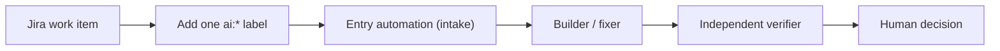

# From Jira to Review-Ready

## Reduce the wait, keep the controls, in 120 minutes

Your team will take one small, synthetic Jira work item and let Copilot Automations carry it from intake, to implementation, to independent verification, then you will decide.

The goal is not to automate everything. The goal is to **remove waiting between steps without removing accountability**.

You work entirely from the **GitHub Copilot App**. This workshop covers Copilot Automations, not Microsoft Copilot Studio.

By the end of the workshop, your team should have:

- One Jira work item routed with an explicit label: `ai:feature`, `ai:bug` or `ai:security`.
- One standalone Shared Automation (a request-readiness check).
- One three-member Automation Group for your path: **New Feature**, **Bug Fix** or **Security Fix**.
- A linked GitHub execution issue and a draft pull request, or an honest, actionable blocker.
- An independent verification report bound to the PR's latest commit.
- A measured timeline of where the time went.
- A human release-handover decision.

<div class="warning" data-title="Keep the scope small">

> Build **one** path, not all three. Use only synthetic data. Nothing is merged or deployed automatically, and a draft PR is not a production release.

</div>

## Workshop rules

1. Every team has its own training repository and its own Jira work item. Do not touch another team's resources.
2. Use the GitHub Copilot App as the only workspace. No terminal, IDE or Jira browser exercise is required.
3. Add **exactly one** Jira routing label, and preserve all other labels on the item.
4. Review every automation's name, repository, tools, triggers and paused state **before** approving creation or activation.
5. Keep humans responsible for acceptance, review and release. Automations never approve or merge.
6. Use synthetic training data only: no customer records, passenger data, credentials or real security findings.
7. Never paste tokens or secrets into prompts, issues, comments or files.
8. Report a stage as successful only when you have evidence for it, not because the previous stage finished.

## What matters

The deliverable is a **correctly routed, traceable flow and an honest decision**. A blocker with a clear explanation is a valid learning result.

Focus on whether you can show: the request, the label, the route, a test that proves behavior, a human decision, and one queue removed or still present.

## Manage your time - Schedule suggestion

| Minutes | Phase | Required outcome |
| --- | --- | --- |
| 00-20 | Read the request and expose the queue | Correct repository, Jira item and route confirmed |
| 20-30 | One automation before a group | A request-readiness report, no code changes |
| 30-45 | Build one complete path | Paused three-member group reviewed, then activated |
| 45-70 | Label once and watch the flow | Linked issue, draft PR and evidence, or explicit blocker |
| 70-85 | Test the change and the workflow | One informed decision and one safety case demonstrated |
| 85-95 | Organizational skills bonus | Skill provenance and actual use in a prepared example |
| 95-107 | Cross-path gallery | You have seen all three paths |
| 107-120 | Release handover and close | One-page outcome sheet; event-only automations switched off |

When the timer expires, stop new work. Runs must be accounted for and event-only automations switched off.

# Before the timer starts

## Minimum prerequisites

Your organizers prepare the Jira project, repositories, integration and policies. Check that these work from your own laptop:

| Requirement | Check |
| --- | --- |
| GitHub account with repository access | You have write access to your team's training repository |
| GitHub Copilot App | The App opens, you are signed in (including SSO), and a model is usable |
| Automations in the App | You can open the Automations view and see group management |
| Jira connection through MCP | In **Customize > MCP**, the approved Jira/Atlassian connection is authorized; **Customize > Installed** lists it |
| Jira access | You can open your team's training work item and edit its labels and comments |
| Pull requests and run evidence | The App can open a PR and show run details |
| Editor or document canvas | You can open a document for the team result sheet |

**Readiness gate:** show your coach the correct repository and Jira item open in the App, one completed read-only interaction (prompt P0), and the ability to open a PR. If your machine is incompatible, pair on a prepared workstation. Do not spend the workshop debugging installations.

## Assign team roles

Choose lightweight roles. Rotate the driver after the standalone automation exercise.

- **Business owner:** checks that the request is clear and decides whether the result is acceptable.
- **App driver:** operates the Copilot App.
- **Quality/security reviewer:** challenges evidence and checks actual outputs, not the agent's confidence.
- **Flow observer:** records timestamps, waits and blockers on a timeline sheet.

## Your team card

Your coach gives you these values. Copy them into the App before starting. The companion [prompt pack](automation-prompt-pack.md) shows the card format and the prompts referenced as P0-P9 below.

```text
TEAM: team-__
REPOSITORY: CUSTOMER_ORG/workshop-team-__
JIRA_ITEM: AFKLAB-___
ROUTE: feature | bug | security
GROUP: New Feature | Bug Fix | Security Fix
```

## How the flow works



| Jira label newly added | Target group | Entry automation |
|---|---|---|
| `ai:feature` | New Feature | Feature intake |
| `ai:bug` | Bug Fix | Bug intake |
| `ai:security` | Security Fix | Security intake |

Jira stays the business source of truth. A GitHub execution issue carries the handoff, the PR carries the change, and shared group artifacts carry the evidence.

---

# Level 1: Read the request and expose the queue

**Minutes 00-20.**

The facilitator draws the current path: Jira submission -> triage queue -> development queue -> test queue -> approval queue -> release. Decide together which waits come from missing information, which from unavailable capacity and which from mandatory policy.

Open your repository and Jira work item in the Copilot App using **P0** and **P1**. Check the expected team, repository, category, synthetic-data boundary and acceptance criteria. The flow observer creates a timeline sheet in the App, leaving unobserved values blank.

### Hints

- Ask the App for a read-only check first. Nothing should change in this level.
- If a requirement is unclear, write the question down; do not guess.

**Checkpoint:** the team can explain what should change, how it will be tested and who will accept it. Do **not** apply a routing label yet.

# Level 2: One automation before a group

**Minutes 20-30.**

Use **P2** to create **Request readiness check**, a standalone Shared Automation. It is manual-only, created **paused**, and can report missing requirements but cannot edit code or grant approval.

Inspect the ownership, selected tools, repository and disabled state. Then explicitly approve one manual run, supplying the sanitized work-item context through the App's Run dialog. Do not assume the automation inherits your chat history.

If a requirement is missing, the business owner corrects it in Jira through the App, preserving other fields. This is a genuine edit, not an instruction to fabricate acceptance criteria.

**Checkpoint:** one useful readiness report and a clear understanding that **Shared** describes ownership, not a group or a trigger.

# Level 3: Build one complete path

**Minutes 30-45.**

Use **P3** plus your path card: **P4-F** (Feature), **P4-B** (Bug) or **P4-S** (Security). The App proposes three members, their tool access and exact handoff settings before creating anything.

1. Review the proposal. Check names, tools, triggers and that everything is paused.
2. Use **P3A** to create the members paused, attach them to one group and complete any ID-dependent references.
3. Your coach uses **P3R** to bind the new entry ID through the prevalidated bridge administration capability.
4. Inspect the new resources, then use **P3B** to approve activation of only those members.

If your coach gives you a precreated group instead, reuse those exact IDs and do not create duplicates. This becomes a group-configuration exercise.

| Member | Start | Output | GitHub rights needed |
|---|---|---|---|
| Intake | External API launch | Ready/blocked brief; one execution issue when ready | Read code/issues/PRs; create an issue; add the path's ready label |
| Builder/fixer | `issue_labeled`, added label `workshop:<route>:ready` | One draft PR and actual check evidence | Read context; commit/push task branch; create draft PR; add verify label |
| Verifier | `pull_request_labeled`, added label `workshop:<route>:verify` | Commit-bound evidence and human decision packet | Read diff/checks; run supported non-mutating checks; comment, but not approve or merge |

The builder and verifier consume **Copilot-produced** events. Enable `allow_copilot_triggers` on those two consuming triggers only, and filter the exact newly added handoff label.

Intake writes the ready brief before adding the ready label. Builder writes the implementation evidence before adding the verify label. The verifier cannot write either handoff label and cannot trigger the earlier stages. A group must not loop automatically after a failed review.

### Hints

- Prefer the portable issue/PR-label handoffs above. Do not assume every catalog capability is configurable through every client.
- Never approve a configuration you have not read.

**Checkpoint:** one group, three matching Shared members, exact bridge target recorded, no accidental schedules or unrelated trigger changes.

# Level 4: Label once and watch the flow

**Minutes 45-70.**

Use **P5** to add exactly your assigned Jira route label. Preserve all unrelated labels; many Jira edit APIs replace the label array rather than append.

Observe separately and record each time:

1. Jira label-change timestamp and bridge decision.
2. API acceptance/task ID, then actual run start.
3. Ready or blocked intake evidence.
4. Execution issue and builder start.
5. Draft PR, test results and verifier start.
6. Final evidence packet bound to the PR's latest commit.

If intake is blocked, resolve the stated problem rather than asking the agent to guess. A new attempt uses the defined rerun procedure from your coach. Do not repeatedly remove and add routing labels.

**Checkpoint:** evidence links are visible in the App. No stage is reported as successful merely because the previous stage completed.

# Level 5: Test the change and the workflow

**Minutes 70-85.**

Use **P6** to review the PR against the source acceptance criteria. The quality/security reviewer checks actual outputs, not the agent's confidence.

Choose one controlled workflow test, assigned by your coach:

- Add an unrelated Jira label while the route label remains: no new dispatch.
- Replay the same integration event with the approved test mechanism: the bridge records a duplicate, not a new job.
- Use a separate ambiguous item with two routing labels: no launch; route conflict is visible.
- Use a separate incomplete item: intake reports the missing input and no builder runs.
- Demonstrate a failed check: the verifier leaves the change blocked.

A replay is an organizer-controlled test, not permission to replay real webhooks or disable authorization.

If the PR needs changes, authorize at most one bounded repair attempt through the App. Refresh implementation evidence for the new commit and explicitly rerun verification for that commit. Do not rely on an old verification label or stale report.

**Checkpoint:** one informed human decision on the PR and one safety case demonstrated.

# Level 6: Organizational skills bonus

**Minutes 85-95.**

The facilitator uses a prepared **Skills-assisted Delivery** group, or an advanced team uses the approved skill-enabled version of its own path. See [the bonus below](#bonus-use-the-organizations-skills-repository) and prompts **P7** and **P8**.

Show one concrete skill contribution: better acceptance criteria, a boundary-case test, an authorization invariant, or a complete release evidence packet. A skill name in a prompt without evidence of loading and use does not count.

# Level 7: Share all three paths

**Minutes 95-107.**

Run two four-minute exchanges plus four minutes of facilitated comparison. A Feature team pairs with Bug, then Security representatives rotate so every table sees both other paths.

Each demonstration uses the same compact format:

- The source request.
- The label and group route.
- A test proving behavior.
- A human decision.
- One queue removed, or still present.

Do not spend the gallery making slides.

# Level 8: Release handover and close

**Minutes 107-120.**

Use **P9** to produce a one-page outcome sheet in the App. The human reviewer chooses **ready for authorized integration**, **needs changes** or **blocked**.

Document the production continuation: approved merge, required CI, deployment to an approved non-production environment, authorized release approval, production deployment and observed health/rollback evidence. These steps remain governed by the customer's actual release process. Keep the real production lead-time field **unknown**.

At minute 117 stop new work. Turn off event-only automations with their supported switches after inspecting running work; disabling future triggers does not prove already-started runs have stopped. Do not delete repositories, groups or artifacts as an automatic cleanup action.

## Record facts, not perceived speed

Use UTC timestamps and source links.

| Symbol | Event | Source |
|---|---|---|
| T0 | Jira item created | Jira |
| T1 | Eligible route label added | Jira change/audit record |
| T2 | Intake actually starts | Cloud run |
| T3 | Ready brief/handoff published | Group artifact + execution issue |
| T4 | Builder actually starts | Cloud run |
| T5 | Draft PR and implementation evidence ready | PR + artifact |
| T6 | Verifier actually starts | Cloud run |
| T7 | Verification complete with required evidence | Verification artifact |
| T8 | Human decision | Recorded reviewer decision |
| T9 | Actual production release | Deployment record; normally unknown in this lab |

Intake wait is `T2-T1`, development handoff wait `T4-T3`, verification handoff wait `T6-T5`, and decision wait `T8-T7`. Elapsed time to verified PR (`T7-T1`) counts only when all required checks pass for the current commit. **Full business lead time is `T9-T0`**, not `T7-T1`.

Do not compare a small lab task with a larger production task. With ten small lab tasks, the honest outcome is a hypothesis and a measurement plan, not a proven ROI claim.

## Final submission checklist

- [ ] The Jira item carries exactly one routing label, and other labels were preserved.
- [ ] The standalone readiness automation ran once, with an approved manual run.
- [ ] The group has three matching Shared members, and only the approved ones were activated.
- [ ] A linked execution issue and draft PR exist, or a clear blocker is documented.
- [ ] The verification report is bound to the PR's latest commit.
- [ ] A human decision is recorded (ready / needs changes / blocked).
- [ ] The timeline lists T0-T8 with sources; T9 stays unknown.
- [ ] Event-only automations are switched off at minute 117.

---

# The three exercise paths

These are synthetic scenario specifications from the organizer's starter kit, not claims about an existing repository. Work on the path your table was assigned (tables 1-4 Feature, 5-7 Bug, 8-10 Security).

## Path A - New Feature: direct-flight filter

**Jira example:** `AFKLAB-101`, Story/Feature, label `ai:feature`, group **New Feature**.

**Business request:** "As a traveler, I want to show only direct flights so I can find a simpler itinerary."

Fixture: four synthetic flights, two with zero stops and two with one stop.

Acceptance criteria:

- Filter off: all four flights remain in their existing order.
- Filter on: exactly the two zero-stop flights remain.
- No matching results: a clear empty state, not a broken screen.
- The control has an accessible name and works by keyboard if a UI is supplied.
- Existing result selection behavior remains unchanged.

| Member | Required work | Stop condition |
|---|---|---|
| Feature intake | Clarify smallest behavior and map each criterion to a check | Ambiguous filtering semantics or missing fixture |
| Feature builder | Implement only the filter and focused tests | Unapproved dependency, data service or unrelated redesign needed |
| Feature verifier | Check behavior, accessibility where applicable and regression risk | Missing/failed evidence or a test of implementation details only |

**Evidence:** filtered/unfiltered assertions, empty-state result, relevant UI interaction evidence, draft PR and scope statement.

**Queue addressed:** request clarification and handoff from definition to implementation. Business acceptance remains human.

## Path B - Bug Fix: overnight flight duration

**Jira example:** `AFKLAB-201`, Bug, label `ai:bug`, group **Bug Fix**.

**Bug report:** "A flight departing before midnight and arriving the next day displays a negative duration."

Use ISO timestamps with explicit offsets. The seeded defect exists in the training starter and is not invented during the lab.

Acceptance criteria:

- `2026-11-16T23:30:00Z` to `2026-11-17T01:10:00Z` is **100 minutes**.
- `2026-11-16T10:00:00+01:00` to `2026-11-16T10:30:00Z` is **90 minutes**.
- Same-day cases remain correct.
- Invalid timestamps and arrival-before-departure follow the starter's documented error contract; the agent must not invent a silent correction.

| Member | Required work | Stop condition |
|---|---|---|
| Bug intake | Establish reproduction, expected/actual result and affected scope | Cannot reproduce or expected behavior is unclear |
| Bug fixer | Add a failing regression test, fix the root cause, rerun checks | Test cannot reproduce the claim or required changes exceed scope |
| Bug verifier | Inspect before/after evidence and offset/date edge cases | Passing tests cover a different behavior or existing checks regress |

**Evidence:** the same regression test fails before and passes after, plus preserved same-day/error behavior.

**Queue addressed:** back-and-forth reproduction and waiting to receive a testable fix.

## Path C - Security Fix: booking ownership check

**Jira example:** `AFKLAB-301`, Security work type or agreed equivalent, label `ai:security`, group **Security Fix**.

**Finding:** "In the synthetic booking service, a logged-in test user can retrieve a booking owned by another test user."

Only the local/training service and invented fixtures are in scope. No production probing, real passenger records, valid customer tokens or external exploitation.

Acceptance criteria:

- Test user A can access A's booking.
- Test user A cannot access B's booking.
- Anonymous access is rejected.
- Denied responses expose no booking fields.
- The code uses the starter's agreed 403/404 policy consistently; do not choose it ad hoc.
- Existing legitimate access remains functional.

| Member | Required work | Stop condition |
|---|---|---|
| Security intake | Confirm the synthetic authorization invariant, sensitivity and affected component | Real incident, exposed secret, unclear ownership policy or unauthorized scope |
| Security fixer | Add the missing server-side ownership check and negative tests | Fix would weaken authentication or require unapproved policy changes |
| Security verifier | Check both denied and legitimate paths; assess residual risk | UI-only protection, missing negative tests, leaked data or unverified behavior |

**Evidence:** negative authorization tests before/after, legitimate-access tests, diff review and residual-risk note. A scanner result alone does not prove the authorization flaw is fixed.

**Queue addressed:** gathering security evidence and packaging a reviewable remediation. Security acceptance and release authorization remain human.

**Real-world extension:** secret exposure requires incident handling and credential rotation, not merely deleting a string from code. This lab intentionally does not use real secret exposure as an exercise.

---

# Troubleshooting & Recovery guide

## Setup still broken at minute 20

Pair with a prepared driver station. A coach handles your setup separately. Do not claim an untested laptop is ready.

## Your group is not ready at minute 45

Your coach provides the exact precreated paused rescue group. Review it and approve activation as you would your own. Do not claim your team authored the rescue configuration.

## The Jira event never arrives

Inspect the App-readable integration status. After five minutes, your coach may approve a manual run with the same sanitized context. Manual dispatch does not prove automatic routing; say so in your outcome sheet.

## The run is accepted but no task is visible

An accepted request is not completed work. Inspect status and correlation first, and ask your coach to reconcile before any retry. Never remove and re-add the label.

## Copilot is stuck or checks exceed the timebox

After three minutes without progress:

1. Stop the broad request.
2. State the smallest reproducible problem.
3. Provide the relevant file or PR and the exact error.
4. Reduce to the original smallest task, or use the rescue baseline and evidence pack. Mark inherited results as inherited, not freshly executed.

## The cloud Jira connection is unavailable

Continue from the sanitized entry payload and write the evidence back to Jira yourself from the App. Do not claim the cloud has Jira access.

## GitHub or a model is unavailable

Use the recorded evidence your coach provides and mark it as a **replay**, not a live end-to-end success.

## The verifier finds a defect

Authorize one bounded repair and a fresh verification for the new commit. A stale review does not apply to a changed PR.

## Duplicate PRs or an uncertain write

Stop new dispatch. Your coach reconciles the exact resources. A label or an artifact filename is not an atomic lock.

## Skills are unavailable

Show provenance and the prepared output, and keep live skill execution marked blocked. Naming a skill does not mean it ran.

---

# Bonus: use the organization's skills repository

Attempt this after your main path, or watch the facilitator's demonstration.

Assume the customer has `CUSTOMER_ORG/engineering-skills` in the same organization. **The skill names below are examples**, mapped to real, reviewed skills during preparation.

| Example skill | Intended contribution | Consumer |
|---|---|---|
| `business-request-readiness` | Turn a request into bounded, testable criteria | Intake |
| `regression-first` | Establish failing evidence before a bug fix | Bug fixer |
| `secure-api-change` | Check identity, ownership and denied-path behavior | Security fixer |
| `release-evidence` | Collect checks, risk, rollback and approval evidence | Verifier |

Same-organization membership does **not** automatically give a cloud run access to another private repository or load its skills. Before the day, a maintainer reviews the skills and installs them from a **pinned commit** into each training repository's `.github/skills/`, recording the source repository, path, commit and content hash.

## Example group: Skills-assisted Delivery

| Member | Skills used | Output |
|---|---|---|
| Request assessor | `business-request-readiness` | Ready/blocked brief with criterion-to-test mapping |
| Focused implementer | `regression-first` for Bug; `secure-api-change` for Security | Draft PR, focused test evidence, skill provenance |
| Evidence reviewer | `release-evidence` | Commit-bound handover with risk, rollback and unresolved approvals |

The group follows the same chain as your path: API entry -> ready issue label -> verify PR label. Use **P7** to prepare the skills and **P8** to create the group, paused and in the designated demo repository only. It must not consume the same labels as an already-active group.

**Demonstration:** run one small request through the group, show the skill-loading evidence and output, then compare the evidence packet with your ordinary exercise. A single trial is not proof of systematic quality or speed improvement.

If a skill is missing, untrusted or blocked by policy, the stage stops visibly. Skills are approved procedural guidance, not authority to add permissions, override approval gates or fetch arbitrary code.

## More bonus ideas

- **Custom agent:** create a narrowly scoped reviewer (for example, an accessibility reviewer for the Feature path) and document what it contributed.
- **Improvement loop:** use the optional after-workshop prompt in the prompt pack to propose, but not apply, one evidence-based change to an automation prompt. Humans approve any change.

# Product references

- [Copilot automations: ownership, availability, triggers and groups](https://docs.github.com/en/copilot/concepts/agent-capabilities/agent-powered-workflows-and-operations/about-automations)
- [Create, test and manage automations](https://docs.github.com/en/copilot/how-tos/use-copilot-agents/cloud-agent/create-automations)
- [Customize the GitHub Copilot App](https://docs.github.com/en/enterprise-cloud@latest/copilot/how-tos/github-copilot-app/customize-github-copilot-app)
- [MCP concepts](https://docs.github.com/en/enterprise-cloud@latest/copilot/concepts/customizations/mcp)
- [Agent skills](https://docs.github.com/en/enterprise-cloud@latest/copilot/concepts/customizations/agent-skills)
- [Native Copilot for Jira integration](https://docs.github.com/en/enterprise-cloud@latest/copilot/how-tos/copilot-integrations/integrate-cloud-agent-with-jira)
